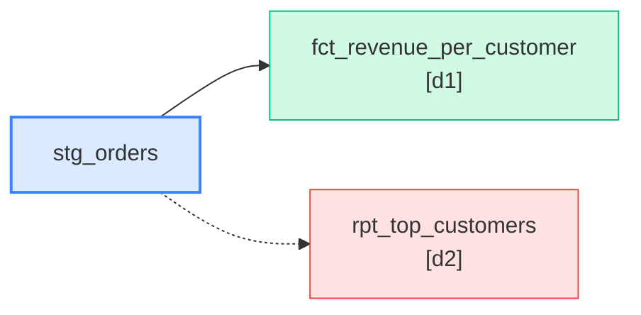

# `dbt-forge impact`

Tell me what would break if I change this model. Useful before you commit, during PR review, and as a CI gate.

```bash
dbt-forge impact <model_name> [options]
```

Walks downstream from the given model and annotates each node with its risk level: are there tests on it? does it feed an exposure (dashboard, ML model, etc.)?

---

## What you see

```bash
$ dbt-forge impact stg_orders

Modifying stg_orders would affect 2 downstream nodes:

  IMMEDIATE (1 hop)
    ✓ fct_revenue_per_customer  [tests: 1]  [exposures: 1: executive_dashboard]

  DOWNSTREAM (2+ hops)
    ✗ rpt_top_customers  [tests: 0 ⚠]  [exposures: 1: executive_dashboard]  (no tests; 1 exposure(s) downstream)

  Risk surface
    1 downstream node has no tests
    1 exposure consumes this lineage
    1 critical, 0 warning
    Total downstream: 2 models
```

Three icons, three risk levels:

| Icon | Level | Meaning |
| --- | --- | --- |
| `✓` | **ok** | tests exist, no immediate concern |
| `⚠` | **warning** | missing test coverage |
| `✗` | **critical** | no tests AND feeds something a human/system consumes |

The classification rules are:
- **critical** — no tests + at least one exposure downstream of this node
- **warning** — no tests, OR has tests but none on the primary key + downstream exposure
- **ok** — otherwise

The "primary key" is detected as the first column declared in the model's `schema.yml`. If a `unique_<model>_<column>` or `not_null_<model>_<column>` test exists for that column, we count it as a PK test.

---

## Options

| Option | Default | Description |
| --- | --- | --- |
| `--depth N` | unlimited | Limit downstream depth |
| `--show-tests / --no-show-tests` | on | Show `[tests: N]` annotation |
| `--show-exposures / --no-show-exposures` | on | Show `[exposures: …]` annotation |
| `--show-config` | off | Show file path for each node |
| `--format ascii\|mermaid\|json` | ascii | Output format |
| `--fail-on critical\|warning\|info` | never | Exit non-zero if max severity ≥ this |
| `--project-dir`, `--target-dir`, `--profiles-dir`, `--no-parse` | — | Same as `lineage` |

---

## JSON output for CI

Use `--format json` to get a structured payload:

```bash
$ dbt-forge impact stg_orders --format json
{
  "target": {
    "name": "stg_orders",
    "unique_id": "model.jaffle_shop.stg_orders",
    "file_path": "models/generated/stg_orders.sql"
  },
  "downstream_count": 2,
  "nodes": [
    {
      "name": "fct_revenue_per_customer",
      "unique_id": "model.jaffle_shop.fct_revenue_per_customer",
      "resource_type": "model",
      "depth": 1,
      "tests_count": 1,
      "has_pk_test": true,
      "exposures": [...],
      "level": "ok",
      "reasons": []
    },
    ...
  ],
  "summary": {
    "without_tests": 1,
    "exposures_affected": 1,
    "by_level": { "ok": 1, "warning": 0, "critical": 1 }
  }
}
```

Pipe through `jq` for ad-hoc analysis:

```bash
$ dbt-forge impact stg_orders --format json \
  | jq '.nodes[] | select(.level == "critical") | .name'
```

---

## In CI: fail the PR on critical findings

```yaml
# .github/workflows/dbt-impact.yml
- name: Run impact check on changed models
  run: |
    for model in $(git diff --name-only origin/main HEAD | grep '\.sql$' | xargs -n1 basename -s .sql); do
      dbt-forge impact "$model" --fail-on critical || exit 1
    done
```

This blocks merging if a changed model has a downstream node that's both untested and consumed by an exposure.

---

## Mermaid output for PR comments

`--format mermaid` produces a graph colored by risk level. Drop it in a PR description and reviewers see at a glance where the danger zones are.



Green nodes are safe, red ones need attention before you merge.
